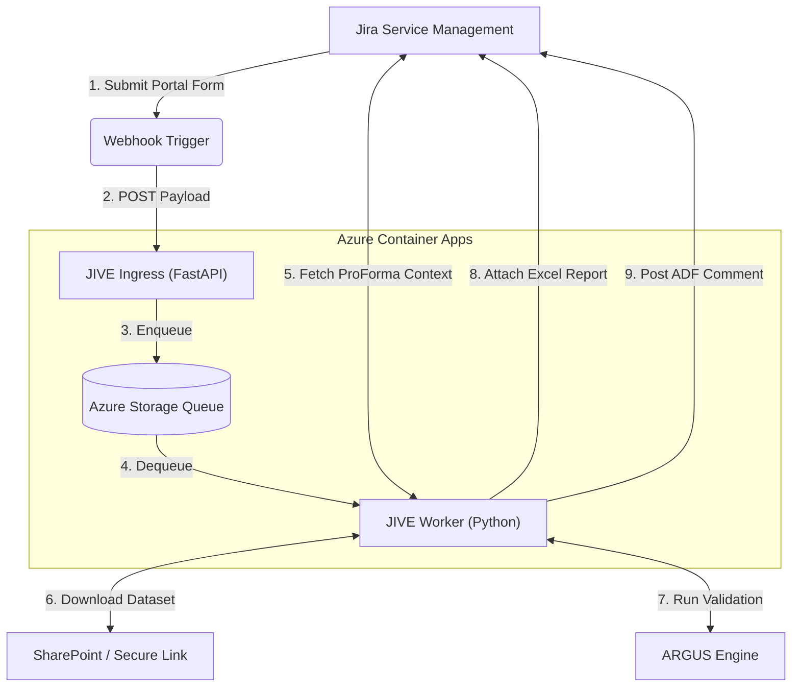

# JIVE — Jira IMPACT Validation Engine

**JIVE** (Jira IMPACT Validation Engine) is an asynchronous, event-driven microservice that automates Research Quality Assurance (RQA) workflows. It bridges the Jira Service Management (JSM) portal with the [Argus](common/argus) engine to automatically download submitted datasets, execute validation pipelines, generate Excel reports, and post structured Atlassian Document Format (ADF) comments back to Jira tickets.

## Overview

Research data collected through household surveys, market assessments, and key informant interviews undergoes rigorous quality assurance before publication. Historically, this involved manual scripts, downloading files, interpreting output, and back-and-forth communication on Teams or email.

JIVE automates this bottleneck. When a country team member submits a dataset for review via a Jira ticket, JIVE automatically:
1. Receives the webhook event from Jira.
2. Extracts dataset context (dataset type, secure links) from Jira ProForma forms.
3. Downloads the dataset securely.
4. Executes the full `ARGUS` pipeline.
5. Generates a multi-sheet Excel report detailing all errors, warnings, and info messages.
6. Posts a formatted summary comment directly on the Jira ticket and attaches the Excel report.

### The Asynchronous Queue Architecture

Data validation is computationally expensive. Datasets can contain hundreds of thousands of rows across multiple sheets, requiring cross-referencing against cleaning logs and complex schema definitions. If this ran synchronously inside a Jira webhook handler (which requires a response within seconds), the HTTP connection would time out and fail.

JIVE solves this by **decoupling ingestion from processing** using Azure Storage Queues and Azure Container Apps:
- **Ingress**: A lightweight FastAPI gateway immediately returns `HTTP 202 Accepted` to Jira and pushes the payload to the queue.
- **Validator**: A background python worker asynchronously pulls jobs from the queue. Leveraging **KEDA** (Kubernetes Event-driven Autoscaling), the worker container scales down to 0 when idle (costing nothing) and scales out dynamically based on the queue length.

---

## Architecture



---

## Project Structure
Within this project there several application groups. Each has its own configuration and deployment files. 

```text

├── api                     FastAPI ingress (webhook endpoint)
├── workers                 Contains individual workers including the validation worker.
├── common                  Shared components that can be resued by workers. This includes the Argus framework, Jira integration and a shared logging framework. 
└── local                   Local exploration and local Docker Compose setup

```

---

## Local Development & Configuration
To set up a local environment for either of the components see their respective readme files:
- [API readme](api/README.md)
- [Validator readme](workers/validator/README.md)
- [Argus readme](common/argus/README.md)
- [local readme](local/README.md)

### Running the Services Locally

We recommend using the provided `local/docker-compose.yml` to mirror the Azure architecture (FastAPI Gateway + Azurite + Validator). Before running this make sure that `api` and `validator` both have an `.env` file set up. To deploy locally to Docker:

```bash
docker compose -f local/docker-compose.yml up --build
```
* **JIVE Ingress Gateway**: Accessible at `http://localhost:8000/api/webhook`
* **Azurite Emulator**: Emulates Azure Storage Queues at `http://localhost:10001`
* **Background Validator**: Polls Azurite for jobs, executes validation, and interacts with Jira.

Alternatively, you can run them locally via `uv`. See:
- [API readme](api/README.md)
- [Validator readme](workers/validator/README.md)

To connect Jira automation components to a locally hosted envrionment an additional service is required to allow Jira to connect to a localhost address. Services like [ngrok](ngrok.com/) can be used for this. 

See this for additional details: [JIVE-ARGUS Demo](https://app.notion.com/p/JIVE-Demo-372e735be74b80cdb994ff0a9d0fbab4)

---


## Roadmap

- [ ] Upload validation reports to Azure Blob Storage and include a SAS download link in the Jira comment instead of attaching the file directly (avoids Jira attachment size limits)
- [ ] Transition the Jira ticket to a target status automatically based on validation results (e.g., move to "Approved" on pass (default: JIRA_TRANSITION_APPROVED), "Needs Revision" on fail (default: JIRA_TRANSITION_REVISION))
- [ ] Add support for multiple dataset types beyond JMMI (MSNA, ESNFI) with automatic schema detection
- [ ] Implement Azure Managed Identity for Key Vault secret retrieval at runtime, removing the need for connection strings in environment variables

---

## Related Repositories
- [`impact-initiatives/argus_schemas`](https://github.com/impact-initiatives/argus_schemas) — Configuration files for Argus datasets.
