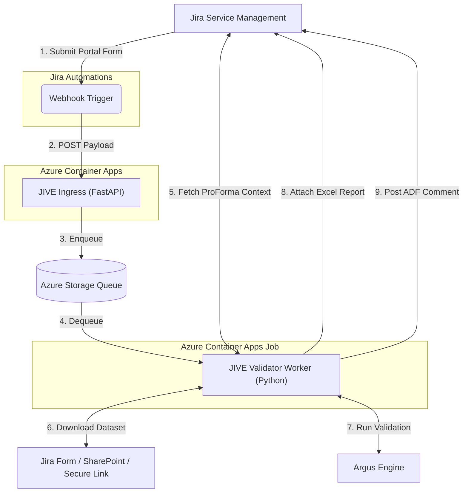

# Jive Validator
The Jive Validator is an asynchronous, event-driven microservice that automates Research Quality Assurance (RQA) data validation workflows. It bridges the Jira Service Management (JSM) portal with the [Argus](../../common/argus) engine to automatically download submitted datasets, execute validation pipelines, generate Excel reports, and post structured Atlassian Document Format (ADF) comments back to Jira tickets.

## Overview

Research data collected through household surveys, market assessments, and key informant interviews undergoes rigorous quality assurance before publication. Historically, this involved manual scripts, downloading files, interpreting output, and back-and-forth communication on Teams or email.

The JIVE validator worker automates this bottleneck. When a country team member submits a dataset for review via a Jira ticket, JIVE automatically:
1. Receives the webhook event from Jira through the [Jive API](../../api).
2. Extracts dataset context (dataset type, secure links) from Jira ProForma forms.
3. Downloads the dataset securely.
4. Executes the full [Argus](../../common/argus) pipeline.
5. Generates a multi-sheet Excel report detailing all errors, warnings, and info messages.
6. Posts a formatted summary comment directly on the Jira ticket and attaches the Excel report.


## Architecture


---

## Components
```
├── Dockerfile
├── src
    ├── tests
    └── validator
        ├── config.py
        ├── excel_exporter.py       Generates multi-sheet Excel validation reports using Polars
        ├── impact_repo_client.py   
        ├── logs.py
        ├── main.py                 Queue consumer (orchestrates validation lifecycle)
        ├── models.py
        ├── proforma_parser.py
        ├── report_formatter.py     Transforms PipelineResponse into Atlassian Document Format (ADF)
        └── worker_utils.py
```

## Related Repositories
- [`impact-initiatives/argus_schemas`](https://github.com/impact-initiatives/argus_schemas) — Configuration files for Argus datasets.


## Validator Local Deployment 
We recommend using the provided `local/docker-compose.yml` to mirror the Azure architecture (FastAPI Gateway + Azurite + Validator). Before running this make sure that `api` and `validator` both have an `.env` file set up. To deploy locally to Docker:

```bash
docker compose -f local/docker-compose.yml up --build
```
* **JIVE Ingress Gateway**: Accessible at `http://localhost:8000/api/webhook`
* **Azurite Emulator**: Emulates Azure Storage Queues at `http://localhost:10001`
* **Background Validator**: Polls Azurite for jobs, executes validation, and interacts with Jira.

To connect Jira automation components to a locally hosted envrionment an additional service is required to allow Jira to connect to a localhost address. Services like [ngrok](ngrok.com/) can be used for this. 

## Validator Local Development & Configuration
These steps are for setting up and running the validator only. 
### Prerequisites
* Python 3.14+
* [uv](https://docs.astral.sh/uv/) package manager
* [Azurite](https://learn.microsoft.com/en-us/azure/storage/common/storage-use-azurite) (Local Azure Storage Emulator)

### Project Environment Setup
To create the python environment run:
```bash
uv sync  --all-extras
```

### Environment Variables
For local deployments using docker a `.env` file is required. Create a `.env` file in the api project root. `.env.example` contains the required environment variables. 

If you want to use this file locally outside of docker then the `config.py` file will need to be updated. Uncomment and configure this code in `config.py` but do not commit the change:
```python 
model_config: SettingsConfigDict = SettingsConfigDict(
    env_file=".env",  # set this to the correct name and location
    env_ignore_empty=True,
    extra="ignore",
)
```

### Running the Services Locally
To run this service use:
```bash
##########
# if the virtual environment is not active for worker
source .venv/bin/activate
##########
uv run -m validator.main
```

### Running Tests
To run tests:
```bash
uv run pytest -v
```
